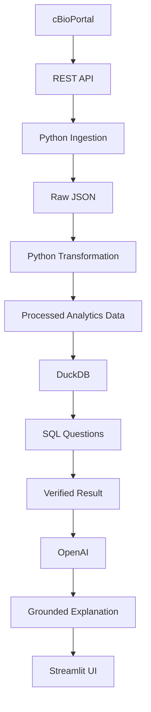
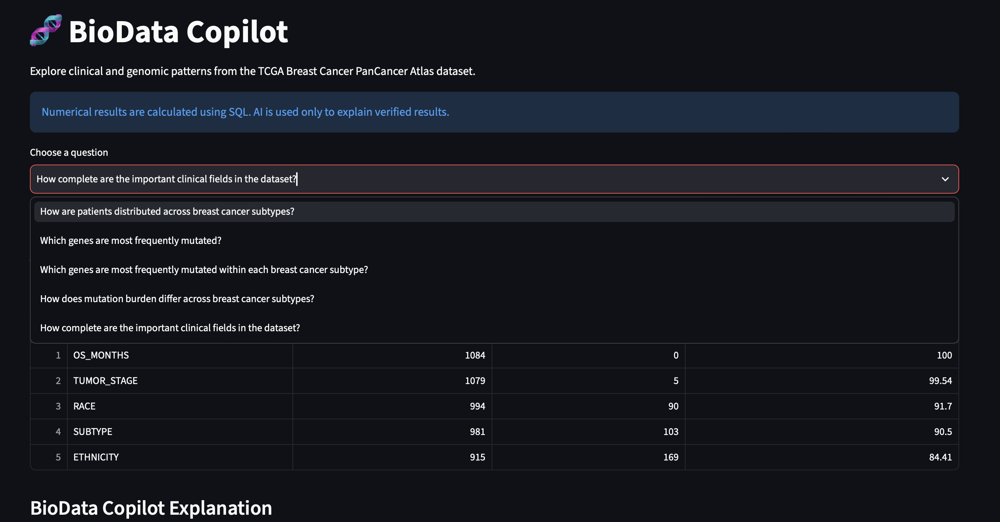
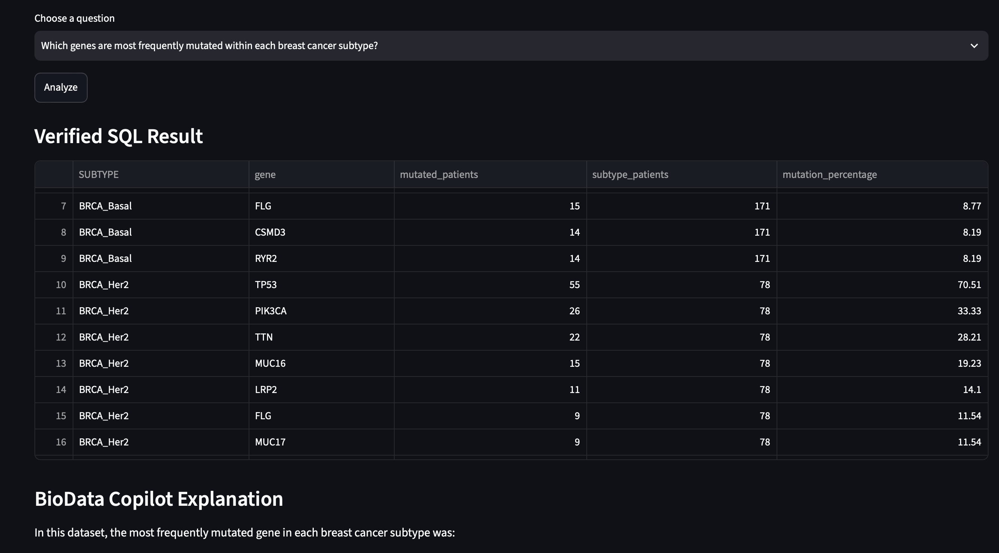
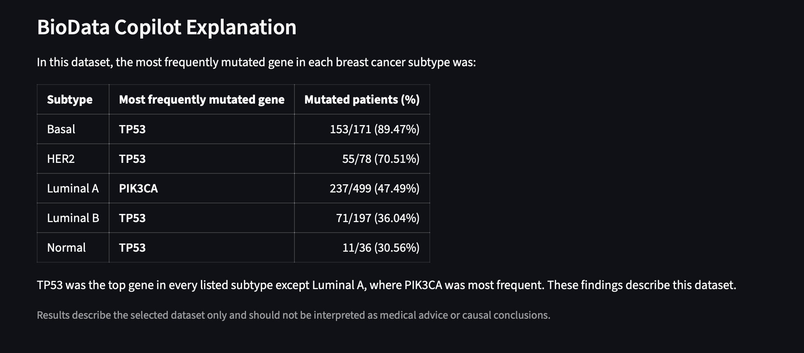

# 🧬 BioData Copilot

BioData Copilot is a biomedical analytics project that combines **data engineering, cancer genomics, SQL analytics, and grounded AI explanations**.

The project uses public breast-cancer data from cBioPortal, processes and transforms the data with Python, loads analytical datasets into DuckDB, calculates results using reviewed SQL, and uses an LLM only to explain those verified results.

> **Core principle:** SQL calculates the facts. AI explains the facts.

---

## Why I Built This

My background combines **Biotechnology** with professional experience in **Data Engineering**.

I built BioData Copilot to explore how data-engineering practices such as:

- reproducible ingestion,
- data-quality checks,
- explicit table grain,
- deterministic analytics,
- and structured data modeling

can be applied to biomedical data and AI-assisted analysis.

The goal is not to use an LLM as a replacement for analytical computation.

Instead, the system separates:

```text
Data processing and calculation
            ↓
Verified analytical result
            ↓
AI explanation
```

This reduces the risk of the language model inventing dataset-specific numerical facts.

---

# Architecture



---

# Dataset

The project uses:

**Study:** Breast Invasive Carcinoma — TCGA PanCancer Atlas

**cBioPortal Study ID:**

```text
brca_tcga_pan_can_atlas_2018
```

The study was selected after comparing multiple cancer studies based on:

- sample coverage,
- clinical attributes,
- molecular profiles,
- study scope,
- and suitability for general biomedical exploration.

V1 focuses on two data domains:

1. Clinical data
2. Mutation data

---

# Data Pipeline

## 1. Ingestion

Python retrieves clinical and mutation data from the cBioPortal REST API.

Raw responses are preserved as JSON.

```text
cBioPortal
    ↓
patient_clinical_data.json
sample_clinical_data.json
mutation_data.json
```

---

## 2. Transformation

Clinical data arrives in long format:

```text
patientId | clinicalAttributeId | value
```

Python converts this into analytical tables such as:

```text
patientId | AGE | SEX | SUBTYPE | OS_MONTHS | ...
```

Nested mutation JSON is also flattened into a tabular structure.

The main processed datasets are:

```text
patient_analytics.csv
sample_analytics.csv
mutation_analytics.csv
```

---

## 3. Analytical Database

The processed datasets are loaded into DuckDB.

| Table | Grain |
|---|---|
| `patient_analytics` | One row per patient |
| `sample_analytics` | One row per sample |
| `mutation_analytics` | One row per mutation record |

Understanding table grain is important because one patient can have many mutation records.

---

## 4. SQL Analytics

Five predefined analytical questions are implemented as SQL files.

BioData Copilot currently supports:

1. How are patients distributed across breast-cancer subtypes?
2. Which genes are most frequently mutated?
3. Which genes are most frequently mutated within each subtype?
4. How does mutation burden differ across subtypes?
5. How complete are important clinical fields?

The SQL layer produces deterministic results before any information reaches the LLM.

---

## 5. Grounded AI Explanation

The verified SQL result is passed to OpenAI with rules that require the model to:

- use only the supplied analytical result,
- avoid inventing numerical values,
- avoid causal claims,
- avoid diagnosis,
- avoid treatment recommendations,
- make clear that results describe the selected dataset.

Example flow:

```text
User Question
      ↓
SQL Query
      ↓
DuckDB
      ↓
Verified DataFrame
      ↓
OpenAI
      ↓
Natural-language Explanation
```

---

# Example Findings

Examples from the selected dataset include:

### Patient subtypes

| Subtype | Patients | Percentage |
|---|---:|---:|
| LumA | 499 | 46.03% |
| LumB | 197 | 18.17% |
| Basal | 171 | 15.77% |
| Unknown | 103 | 9.50% |
| HER2 | 78 | 7.20% |
| Normal | 36 | 3.32% |

### Frequently mutated genes

Examples include:

- TP53
- PIK3CA
- TTN
- CDH1
- GATA3

Patient-level mutation frequency uses unique patient-gene combinations rather than raw mutation-row counts.

### Mutation prevalence by subtype

Examples from the selected dataset:

- TP53 in Basal: 89.47%
- TP53 in HER2: 70.51%
- PIK3CA in LumA: 47.49%
- TP53 in LumB: 36.04%

These are descriptive results from this dataset and should not automatically be generalized to broader patient populations.

---

# Demo

### Application Home



### Verified Genomic Analysis

The analytical result is calculated in DuckDB using reviewed SQL.



### Grounded AI Explanation

The verified SQL result is then passed to the LLM for explanation.



---

# Data-Engineering Lessons

Several issues encountered during development were important to the final design.

### Sequenced does not mean mutated

The mutation-profile sample list contained:

```text
1,066 sequenced samples
```

while mutation records existed for:

```text
1,009 samples
```

A sequenced sample may have no returned mutation calls.

---

### Mutation rows are not patient counts

One patient can have multiple mutation records for the same gene.

Therefore:

```sql
COUNT(*)
```

and:

```sql
COUNT(DISTINCT patientId)
```

answer different questions.

---

### Raw counts can be misleading across groups

Subtype sizes differ substantially.

Mutation prevalence therefore uses percentages rather than comparing only raw patient counts.

---

### Mean and median can tell different stories

High mutation-count observations can strongly affect averages.

Both mean and median are used when describing mutation burden.

---

# Project Structure

```text
biodata-copilot/
│
├── app/
│   └── app.py
│
├── data/
│   ├── raw/
│   └── processed/
│
├── docs/
│
├── scripts/
│   ├── explore_dataset.py
│   └── check_mutation_coverage.py
│
├── sql/
│   └── questions/
│       ├── 01_subtype_distribution.sql
│       ├── 02_top_mutated_genes.sql
│       ├── 03_top_genes_by_subtype.sql
│       ├── 04_mutation_burden_by_subtype.sql
│       └── 05_data_completeness.sql
│
├── src/
│   └── biodata_copilot/
│       ├── ai/
│       ├── database/
│       ├── ingestion/
│       └── transformation/
│
├── tests/
│   └── test_data_quality.py
│
├── .env.example
├── .gitignore
├── pyproject.toml
└── uv.lock
```

# Documentation

More detailed project documentation is available under `docs/`:

- [Architecture](docs/architecture.md) — system components, data flow, and architectural rationale
- [Dataset Selection](docs/dataset_selection.md) — how the TCGA Breast PanCancer study was selected
- [Design Decisions](docs/decisions.md) — major engineering decisions and their reasoning
- [Development Journey](docs/development_journey.md) — implementation journey, mistakes, discoveries, and lessons

---

# Getting Started

## Requirements

- Python 3.12+
- `uv`
- OpenAI API key

---

## 1. Clone the repository

```bash
git clone <repository-url>
cd biodata-copilot
```

---

## 2. Install dependencies

```bash
uv sync
```

---

## 3. Configure the OpenAI API key

Copy the example environment file:

```bash
cp .env.example .env
```

Then add your OpenAI API key:

```text
OPENAI_API_KEY=your_api_key_here
```

The `.env` file is excluded from Git.

---

## 4. Fetch the source data

```bash
uv run python src/biodata_copilot/ingestion/fetch_clinical_data.py
```

```bash
uv run python src/biodata_copilot/ingestion/fetch_mutation_data.py
```

---

## 5. Transform the data

```bash
uv run python src/biodata_copilot/transformation/transform_clinical_data.py
```

```bash
uv run python src/biodata_copilot/transformation/create_mutation_analytics.py
```

---

## 6. Build the DuckDB database

```bash
uv run python src/biodata_copilot/database/load_duckdb.py
```

---

## 7. Run the tests

```bash
uv run pytest -q
```

---

## 8. Start the application

```bash
uv run streamlit run app/app.py
```

Streamlit will provide a local URL, typically:

```text
http://localhost:8501
```

---

# Testing

The current automated tests check:

- expected patient row count,
- expected sample row count,
- expected mutation row count,
- patient ID uniqueness,
- sample ID uniqueness,
- patient/sample relationship,
- completeness of critical mutation fields,
- expected mutation patient/sample counts.

Run:

```bash
uv run pytest -q
```

---

# Technology Stack

### Data Engineering

- Python
- Pandas
- REST APIs
- DuckDB
- SQL

### AI

- OpenAI API
- grounded explanation workflow

### Application

- Streamlit

### Development

- `uv`
- Git
- pytest

---

# Design Decisions

### Why DuckDB instead of a cloud warehouse?

The dataset is approximately 100 MB and comfortably fits on one machine.

Using distributed processing or a managed cloud warehouse would introduce infrastructure complexity without solving a current scalability requirement.

Google Cloud Storage and BigQuery were explored during development, but V1 was intentionally redesigned as a local-first architecture.

---

### Why predefined questions instead of natural-language-to-SQL?

V1 prioritizes reliability and reproducibility.

Each supported question maps to reviewed SQL rather than allowing an LLM to dynamically generate arbitrary SQL.

Natural-language-to-SQL may be evaluated as a future extension.

---

### Why not use Spark?

The current data volume does not justify distributed processing.

Technology choices were based on project requirements rather than adding tools purely for portfolio breadth.

---

# Limitations

BioData Copilot V1:

- uses one cancer study,
- focuses only on clinical and mutation data,
- supports a small predefined question set,
- does not establish causation,
- does not provide medical advice,
- does not make treatment recommendations,
- does not replace clinical or scientific interpretation.

The system currently evaluates associations and descriptive patterns within the selected dataset only.

---

# Future Research Direction

A possible V2 extension will investigate a broader trustworthy-AI question:

> **Can provenance-aware evidence constraints reduce scientific overclaiming in LLM explanations of structured cancer-genomics analyses?**

Potential evaluation areas include:

- numerical fidelity,
- unsupported scientific claims,
- causal overreach,
- clinical overreach,
- appropriate abstention,
- provenance completeness.

This would extend BioData Copilot from an engineering system into an experimental framework for studying trustworthy AI over biomedical data.

---

# Responsible Use

BioData Copilot is an educational and analytical project.

It is not intended for:

- diagnosis,
- treatment selection,
- clinical decision-making,
- individual patient risk prediction.

All results should be interpreted within the scope and limitations of the underlying dataset.

---

# Author

**Haneefa Tasneem Shaik**

Biotechnology graduate and Data Engineer interested in the intersection of:

- Data Engineering
- Artificial Intelligence
- Bioinformatics
- Biomedical Data Science
- Trustworthy AI