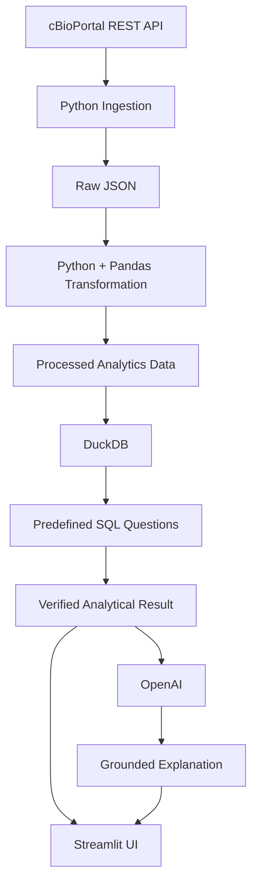
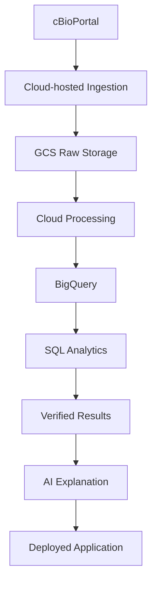

# BioData Copilot — Architecture

## Overview

BioData Copilot is designed around a simple principle:

> **SQL calculates dataset-specific facts. The LLM explains verified results.**

The system intentionally separates:

- data ingestion,
- structural transformation,
- analytical computation,
- AI explanation,
- and presentation.

This keeps the numerical logic reproducible and reviewable instead of asking the language model to perform every analytical step itself.

---

## V1 Architecture



---

## Component Responsibilities

### cBioPortal

cBioPortal is the public biomedical data source.

The selected study is:

`brca_tcga_pan_can_atlas_2018`

V1 uses:

- clinical data,
- mutation data.

---

### Python Ingestion

Python retrieves data from the cBioPortal REST API.

Responsibilities include:

- API requests,
- HTTP error handling,
- JSON parsing,
- saving the original API responses.

Raw source data is preserved before transformation.

---

### Raw Data Layer

Raw API responses are stored under:

`data/raw/`

Examples:

- `patient_clinical_data.json`
- `sample_clinical_data.json`
- `mutation_data.json`

This layer exists for:

- traceability,
- reproducibility,
- debugging,
- rebuilding downstream datasets.

---

### Python + Pandas Transformation

Python and pandas handle structural transformations before analytical SQL.

Clinical data is converted from long format:

`patientId | clinicalAttributeId | value`

into wide analytical structures such as:

`patientId | AGE | SEX | SUBTYPE | OS_MONTHS | ...`

Nested mutation JSON is flattened into tabular mutation records.

The main outputs are:

- `patient_analytics.csv`
- `sample_analytics.csv`
- `mutation_analytics.csv`

---

## Data Model

The three analytical datasets have different grains.

### Patient Analytics

`1 row = 1 patient`

### Sample Analytics

`1 row = 1 biological sample`

### Mutation Analytics

`1 row = 1 mutation record`

For the selected study, the observed relationship is:

```text
Patient
   |
   | 1 : 1
   v
Sample

Patient
   |
   | 1 : many
   v
Mutation records
```

Understanding grain is important because incorrect joins can inflate patient counts.

For patient-level gene analysis, mutation rows are therefore evaluated using unique patient-gene combinations where appropriate.

---

## DuckDB

DuckDB is the V1 analytical database.

Processed CSVs are loaded into:

- `patient_analytics`
- `sample_analytics`
- `mutation_analytics`

DuckDB was selected because the current dataset is small enough to process comfortably on one machine while still providing a full SQL analytical layer.

The project does not currently require a managed cloud warehouse.

---

## SQL Analytics

SQL is responsible for deterministic analytical calculations.

The current V1 question set includes:

1. patient distribution across breast-cancer subtypes,
2. most frequently mutated genes,
3. most frequently mutated genes within each subtype,
4. mutation burden and TMB across subtypes,
5. clinical-field completeness.

Each supported question maps to a reviewed SQL file under:

`sql/questions/`

This means the LLM is not responsible for dynamically generating the underlying numerical analysis.

---

## Verified Analytical Result

DuckDB executes the SQL query and returns the trusted analytical result.

Examples include:

- patient counts,
- percentages,
- mutation frequencies,
- subtype-level comparisons,
- mutation burden,
- completeness metrics.

These results are produced before the LLM is called.

---

## OpenAI Explanation Layer

OpenAI receives:

1. the supported user question,
2. the verified SQL result.

The model is instructed to:

- use only the supplied analytical result,
- avoid inventing numerical values,
- state that findings describe the selected dataset,
- avoid causal claims,
- avoid diagnosis,
- avoid treatment recommendations.

The purpose of the LLM is explanation, not analytical computation.

---

## Streamlit Interface

Streamlit provides a lightweight V1 interface.

The user can:

1. select a supported analytical question,
2. run the corresponding SQL query,
3. view the verified result,
4. view the grounded AI explanation.

V1 intentionally does not provide unrestricted natural-language-to-SQL.

---

## Data Quality

Exploratory profiling was used during development to understand:

- duplicates,
- missing values,
- patient/sample relationships,
- mutation coverage,
- data types,
- outliers.

Stable expectations were later converted into automated pytest checks.

Current tests verify important conditions such as:

- expected table sizes,
- unique patient IDs,
- unique sample IDs,
- patient/sample consistency,
- completeness of critical mutation identifiers.

---

## Why Local-First?

Google Cloud Storage and BigQuery were explored during development.

However, the final V1 architecture was intentionally changed to local-first.

The current dataset contains approximately:

- 1,084 patients,
- 84,226 mutation records,
- around 100 MB of raw data.

This workload does not require distributed processing or a managed cloud warehouse.

Using GCP as a mandatory component would introduce additional:

- infrastructure,
- authentication,
- deployment,
- and billing complexity

without solving a current scale requirement.

The architecture therefore follows:

`Problem → Requirements → Architecture → Technology`

rather than:

`Technology → Find somewhere to use it`

---

## Optional Future Cloud Architecture

If the project later requires:

- scheduled execution,
- centralized storage,
- multiple users,
- larger datasets,
- production deployment,

the architecture could evolve toward:



GCP is therefore a possible future deployment architecture, not a requirement of V1.

---

## Architecture Summary

```text
cBioPortal
    ↓
Python ingestion
    ↓
Raw JSON
    ↓
Python / pandas transformation
    ↓
Processed analytical datasets
    ↓
DuckDB
    ↓
Reviewed SQL
    ↓
Verified result
    ↓
OpenAI explanation
    ↓
Streamlit
```

The core engineering objective is to keep analytical facts reproducible while using AI only where natural-language interpretation adds value.