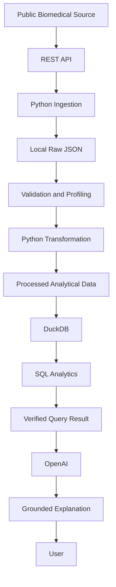
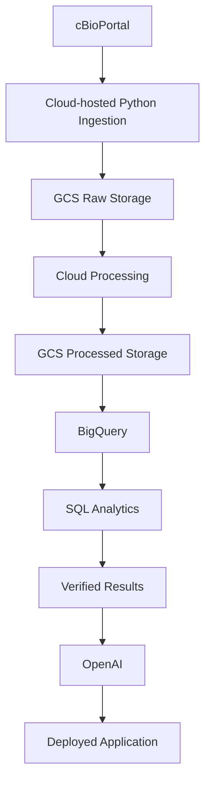

# BioData Copilot — Architecture

## V1 Data Flow

## Architecture Principle

BioData Copilot separates data processing from AI explanation.

The analytical layer calculates dataset-specific facts.

The LLM explains those verified facts.

The LLM is not responsible for calculating patient counts, mutation frequencies, survival statistics, or other numerical results.

---

## Component Responsibilities

### Public Biomedical Source

cBioPortal provides the original biomedical data used by the project.

The selected study is:

`brca_tcga_pan_can_atlas_2018`

The V1 project uses:

- clinical data
- mutation data

---

### REST API

The cBioPortal REST API provides structured access to:

- study metadata
- clinical attributes
- patient clinical data
- sample clinical data
- molecular profiles
- mutation records

The API returns data primarily in JSON format.

---

### Python Ingestion

Python communicates with the cBioPortal API and retrieves source data.

Responsibilities include:

- API requests
- HTTP error handling
- JSON parsing
- saving raw source data
- selecting appropriate API endpoints

Raw data is preserved before transformation.

---

### Local Raw Storage

Raw API responses are stored locally under:

`data/raw/`

Examples:

- `patient_clinical_data.json`
- `sample_clinical_data.json`
- `mutation_data.json`

The raw layer preserves the source data so transformations can be reproduced or investigated later.

---

### Validation and Profiling

Python validation scripts inspect the source data before analytical transformation.

Checks include:

- row counts
- unique entity counts
- duplicate detection
- attribute completeness
- patient/sample relationships
- mutation coverage
- missing critical identifiers
- value distributions
- unusual values and outliers

The purpose is to understand the data before modifying it.

---

### Python Transformation

Python and pandas handle structural transformations that are easier to perform before SQL analysis.

Examples include:

- converting long clinical data into wide format
- flattening nested mutation JSON
- selecting V1-relevant fields
- creating analytical CSV datasets

The main processed outputs are:

`data/processed/patient_analytics.csv`

`data/processed/sample_analytics.csv`

`data/processed/mutation_analytics.csv`

---

### DuckDB

DuckDB will act as the analytical database for V1.

It will store or query the processed datasets and provide the SQL analytical layer.

DuckDB was selected because the current dataset is small enough to process comfortably on a single machine.

The project does not currently require a managed cloud warehouse.

---

### SQL Analytics

SQL will be responsible for analytical modeling.

Examples include:

- patient and sample joins
- patient and mutation joins
- subtype summaries
- mutation-frequency calculations
- gene-level patient counts
- survival summaries
- reusable analytical views or tables

SQL produces deterministic results that can be verified independently of the LLM.

---

### Verified Query Result

The output of SQL becomes the trusted analytical result.

Examples:

- number of patients in each subtype
- patients with TP53 mutations
- most frequently mutated genes
- mutation frequencies by subtype
- average age by clinical group

These verified results become the input to the AI explanation layer.

---

### OpenAI

OpenAI explains verified analytical results in natural language.

Its responsibilities include:

- explaining results clearly
- summarizing patterns
- providing context
- distinguishing observations from stronger interpretations

OpenAI should not invent dataset-specific numerical facts.

---

### User Interface

The user interface will allow a student or researcher to explore supported biomedical questions.

The interface will display:

- analytical results
- summaries
- grounded AI explanations

V1 will support a limited set of predefined analytical questions rather than unrestricted natural-language-to-SQL.

---

## Data Layers

The project uses three main local data layers.

### Raw Layer

Original API responses.

Examples:

`patient_clinical_data.json`

`sample_clinical_data.json`

`mutation_data.json`

### Intermediate Layer

Structurally transformed datasets retained for traceability.

Examples:

`patient_clinical_wide.csv`

`sample_clinical_wide.csv`

### Analytics Layer

Curated datasets used by the analytical database.

Examples:

`patient_analytics.csv`

`sample_analytics.csv`

`mutation_analytics.csv`

---

## Optional Cloud Architecture

Google Cloud was explored during development.

The following components were successfully tested:

- Google Cloud project setup
- Google Cloud CLI
- Application Default Credentials
- Google Cloud Storage
- Python `google-cloud-storage`
- raw-data uploads
- processed-data uploads

A possible future cloud architecture is:

GCP is not required for V1.

It can be introduced later if the project requires:

- scheduled cloud execution
- centralized storage
- multiple users
- production deployment
- managed infrastructure
- larger-scale data processing

---

## Architecture Decision

The current V1 follows:

`Problem → Requirements → Architecture → Technology`

The current dataset is approximately:

- 100 MB of raw data
- 1,084 patients
- 84,226 mutation records

This scale does not require distributed processing or a managed cloud warehouse.

Therefore, BioData Copilot V1 uses a local-first architecture while keeping GCP as an optional future extension.

cBioPortal
    ↓
Python ingestion
    ↓
Raw JSON
    ↓
Validation + transformation
    ↓
Processed CSVs
    ↓
DuckDB ✅
    ↓
SQL analytical models ✅
    ↓
Verified analytical results
    ↓
OpenAI ⏳
    ↓
User Interface ⏳

# Current Next Step

Define the small set of analytical questions that BioData Copilot V1 will officially support.

The next phase will:

1. select 3–5 useful biomedical questions,
2. create reusable SQL queries for those questions,
3. return deterministic structured results,
4. pass only those verified results to the OpenAI explanation layer.