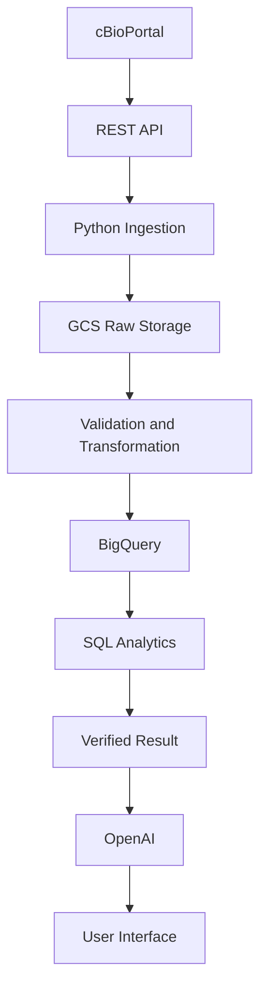
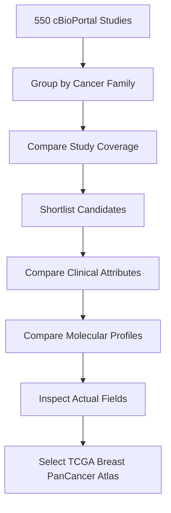

cat > docs/project_journey.md <<'EOF'
# BioData Copilot — Project Journey

## Project Goal

Build a biomedical data platform that:

1. retrieves public biomedical data,
2. preserves raw data,
3. validates and transforms it,
4. stores analytical data in BigQuery,
5. answers questions using SQL,
6. uses an LLM to explain verified results.

---

# Current Architecture

---

# Progress

| Phase | Status |
|---|---|
| Project setup | ✅ |
| API understanding | ✅ |
| Study exploration | ✅ |
| Cancer-family grouping | ✅ |
| Candidate comparison | ✅ |
| Dataset selection | ✅ |
| Actual clinical-data ingestion | ⏳ |
| Mutation-data ingestion | ⏳ |
| GCS | ⏳ |
| Data validation | ⏳ |
| BigQuery | ⏳ |
| OpenAI | ⏳ |
| UI | ⏳ |

---

# Selected Dataset

Study ID:

`brca_tcga_pan_can_atlas_2018`

Study:

Breast Invasive Carcinoma — TCGA PanCancer Atlas

---

# Why This Dataset

Provides broad:

- demographic data
- tumour stage
- subtype
- survival
- mutation data
- gene expression
- copy-number information
- methylation
- protein information
- structural variants

---

# Dataset Selection Flow

---

# Scripts So Far

| Script | Purpose |
|---|---|
| `explore_studies.py` | Initial cBioPortal exploration |
| `compare_cancer_types.py` | Cancer-family comparison |
| `compare_candidate_studies.py` | Candidate metadata comparison |
| `inspect_study.py` | Detailed study inspection |

---

# Key Lessons

1. The biggest dataset is not automatically the best dataset.
2. More columns do not automatically mean better data.
3. Structured metadata is better than relying only on text searches.
4. Related cancer types may need to be grouped using hierarchy.
5. Start with simple Python and refactor later.
6. The LLM should not be the source of numerical truth.

---

# V1 Scope

Use:

- Clinical data
- Mutation data

Not yet:

- mRNA analysis
- methylation analysis
- protein analysis
- RAG
- ML models
- natural-language-to-SQL

---

# Current Next Step

Retrieve actual clinical records from:

`brca_tcga_pan_can_atlas_2018`

Then determine:

1. what the API response looks like,
2. whether records are patient-level or sample-level,
3. how many records exist,
4. how attributes are represented,
5. how raw data should be stored.
EOF