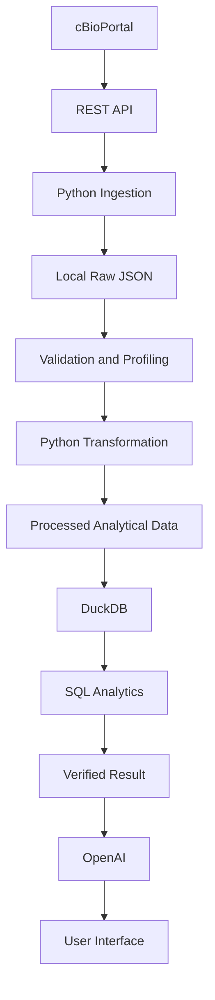
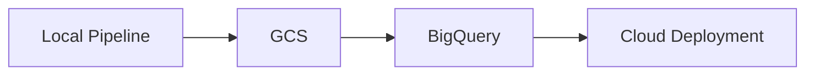
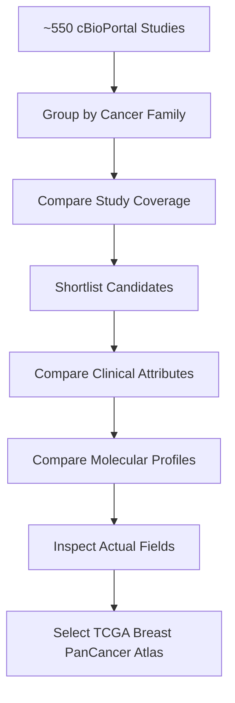

# BioData Copilot — Project Journey

## Project Goal

Build a biomedical data platform that:

1. retrieves public biomedical data,
2. preserves the original source,
3. validates and transforms the data,
4. models the data for analytical SQL,
5. generates verified analytical results,
6. uses an LLM to explain those results.

---

# Current V1 Architecture



## Optional Cloud Extension



GCP was successfully explored but is not required for V1.

---

# Progress

| Stage | Status |
|---|---|
| Project setup | ✅ |
| cBioPortal API exploration | ✅ |
| Cancer-family comparison | ✅ |
| Candidate-study comparison | ✅ |
| Dataset selection | ✅ |
| Clinical-data ingestion | ✅ |
| Clinical-data profiling | ✅ |
| Patient/sample relationship validation | ✅ |
| Clinical long-to-wide transformation | ✅ |
| Wide-table validation | ✅ |
| Clinical value/type profiling | ✅ |
| Patient analytics dataset | ✅ |
| Sample analytics dataset | ✅ |
| Mutation-data ingestion | ✅ |
| Mutation-data profiling | ✅ |
| Mutation coverage validation | ✅ |
| Mutation analytics dataset | ✅ |
| Mutation analytics validation | ✅ |
| GCP/GCS exploration | ✅ |
| DuckDB analytical layer | ⏳ |
| SQL analytical models | ⏳ |
| OpenAI explanation layer | ⏳ |
| User interface | ⏳ |

---

# Selected Dataset

Study ID:

`brca_tcga_pan_can_atlas_2018`

Study:

Breast Invasive Carcinoma — TCGA PanCancer Atlas

---

# Why This Dataset

The study provides broad:

- demographic data
- tumour stage
- breast-cancer subtype
- survival information
- mutation data
- gene expression
- copy-number information
- methylation
- protein information
- structural variants

The study was selected because it provides general-purpose clinical and molecular coverage rather than being focused on a single specialised research question.

---

# Dataset Selection Flow



---

# Clinical Data Journey

cBioPortal clinical data was returned in long format:

`patientId | clinicalAttributeId | value`

Python transformed this into wide analytical tables.

## Patient Clinical Data

Raw:

- 41,497 records
- 1,084 patients
- 40 attributes

Wide:

- 1,084 rows
- 42 columns

Analytics:

- 1,084 rows
- 17 columns

## Sample Clinical Data

Raw:

- 19,348 records
- 1,084 samples
- 18 attributes

Wide:

- 1,084 rows
- 21 columns

Analytics:

- 1,084 rows
- 12 columns

---

# Patient–Sample Relationship

The selected study contains:

- 1,084 unique patients
- 1,084 unique samples
- 0 patients with multiple samples

Observed relationship:

`1 patient → 1 sample`

This simplifies future patient/sample joins.

---

# Mutation Data Journey

Mutation profile:

`brca_tcga_pan_can_atlas_2018_mutations`

Mutation sample list:

`brca_tcga_pan_can_atlas_2018_sequenced`

## Mutation Coverage

- Total study samples: 1,084
- Sequenced samples: 1,066
- Samples with at least one mutation record: 1,009
- Sequenced samples with no returned mutation record: 57

Important distinction:

`sequenced sample ≠ sample with a mutation`

---

# Mutation Dataset

Raw mutation records:

`84,226`

Unique patients with mutation records:

`1,009`

Unique samples with mutation records:

`1,009`

Unique genes represented:

`16,488`

---

# Mutation Analytics Dataset

The nested mutation JSON was flattened into:

`data/processed/mutation_analytics.csv`

Result:

- 84,226 rows
- 19 columns
- 1,009 patients
- 1,009 samples
- 16,488 genes

Critical-field validation:

- missing `patientId`: 0
- missing `sampleId`: 0
- missing `gene`: 0
- missing `mutationType`: 0

Row-count validation:

`PASSED`

---

# Important Mutation Finding

Raw mutation-record counts are not the same as patient-level gene mutation counts.

A patient can contribute multiple mutation records for the same gene.

Therefore, patient-level gene frequency is calculated using unique:

`patientId + gene`

pairs.

Examples:

- TP53: 347 patients
- PIK3CA: 347 patients
- TTN: 187 patients
- CDH1: 130 patients
- GATA3: 127 patients

---

# Processed V1 Data

The main processed datasets are:

```text
data/processed/
├── patient_analytics.csv
├── sample_analytics.csv
└── mutation_analytics.csv
```

Intermediate wide clinical datasets are retained for traceability:

```text
patient_clinical_wide.csv
sample_clinical_wide.csv
```

---

# GCP Exploration

Google Cloud was explored after the local processing layer had been built.

## Completed

- Google Cloud CLI installation
- Google account authentication
- Google Cloud project setup
- Application Default Credentials
- GCS raw bucket
- GCS processed bucket
- raw JSON upload
- processed CSV upload
- Python `google-cloud-storage` integration

## Key Learning

The same cloud operation can be performed through:

- Google Cloud Console
- `gcloud` CLI
- Python SDK

Authentication and authorization are separate concerns:

`Authentication → Who are you?`

`Authorization → What are you allowed to do?`

ADC was used so Python could authenticate without storing credential files inside the repository.

---

# Architecture Reassessment

After experimenting with GCP, the architecture was reassessed.

The current dataset is small enough to process comfortably on a local machine.

Most ingestion, validation, and transformation already occur locally.

Therefore, making GCS and BigQuery mandatory would add complexity without currently solving a scale, collaboration, or deployment requirement.

## Decision

V1 will be local-first.

DuckDB will be used for the SQL analytical layer.

GCP remains a possible Phase 2 deployment option.

This follows the principle:

`Problem → Requirements → Architecture → Technology`

rather than:

`Technology → Find somewhere to use it`

---

# Key Lessons

1. The biggest dataset is not automatically the best dataset.
2. More columns do not automatically mean better data.
3. Structured metadata is better than relying only on text search.
4. Related cancer types may need hierarchy-based grouping.
5. Preserve raw source data before transformation.
6. Validate transformations rather than assuming successful execution means correct data.
7. Missing values should not be filled without a reason.
8. Outliers should not be removed without evidence.
9. Raw mutation rows are different from patient-level mutation frequency.
10. Python is useful for API and semi-structured data processing.
11. SQL should handle analytical joins, aggregations, and marts.
12. The LLM should explain verified facts rather than generate them.
13. Cloud technology should be introduced only when it solves a real requirement.
14. Distributed processing is unnecessary for the current dataset size.

---

# V1 Scope

Use:

- Clinical data
- Mutation data
- Python
- Pandas
- DuckDB
- SQL
- OpenAI
- Simple UI

Not yet:

- gene-expression analysis
- methylation analysis
- protein analysis
- RAG
- ML models
- natural-language-to-SQL
- Spark
- production cloud deployment

---

# Current Next Step

Introduce DuckDB as the local analytical database.

Next:

1. create the local DuckDB database,
2. load patient analytics,
3. load sample analytics,
4. load mutation analytics,
5. validate table row counts,
6. begin SQL analytical modeling.