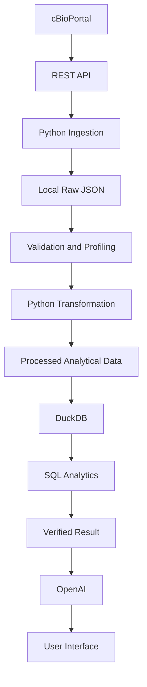
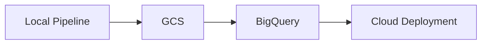
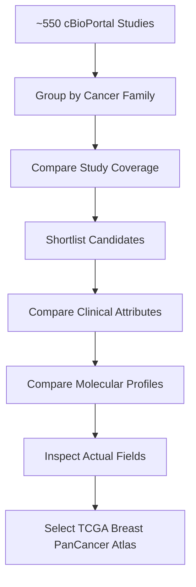

# BioData Copilot — Project Journey

## Project Goal

Build a biomedical data platform that:

1. retrieves public biomedical data,
2. preserves the original source,
3. validates and transforms the data,
4. models the data for analytical SQL,
5. generates verified analytical results,
6. uses an LLM to explain those results.

---

# Current V1 Architecture



## Optional Cloud Extension



GCP was successfully explored but is not required for V1.

---

# Progress

| Stage | Status |
|---|---|
| Project setup | ✅ |
| cBioPortal API exploration | ✅ |
| Cancer-family comparison | ✅ |
| Candidate-study comparison | ✅ |
| Dataset selection | ✅ |
| Clinical-data ingestion | ✅ |
| Clinical-data profiling | ✅ |
| Patient/sample relationship validation | ✅ |
| Clinical long-to-wide transformation | ✅ |
| Wide-table validation | ✅ |
| Clinical value/type profiling | ✅ |
| Patient analytics dataset | ✅ |
| Sample analytics dataset | ✅ |
| Mutation-data ingestion | ✅ |
| Mutation-data profiling | ✅ |
| Mutation coverage validation | ✅ |
| Mutation analytics dataset | ✅ |
| Mutation analytics validation | ✅ |
| GCP/GCS exploration | ✅ |
| DuckDB analytical database | ✅ |
| Table-grain analysis | ✅ |
| Initial SQL analytical models | ✅ |
| V1 analytical question design | ⏳ |
| OpenAI explanation layer | ⏳ |
| User interface | ⏳ |

---

# Dataset Selection

## Selected Study

**Study ID:** `brca_tcga_pan_can_atlas_2018`

**Study:** Breast Invasive Carcinoma — TCGA PanCancer Atlas

## Why This Dataset

The study provides broad:

- demographic data
- tumour stage
- breast-cancer subtype
- survival information
- mutation data
- gene expression
- copy-number information
- methylation
- protein information
- structural variants

The study was selected because it provides general-purpose clinical and molecular coverage rather than being focused on one narrow research question.

---

# Dataset Selection Flow



---

# Clinical Data Journey

cBioPortal clinical data was returned in long format:

`patientId | clinicalAttributeId | value`

Python transformed this into wide analytical tables.

## Patient Clinical Data

Raw:

- 41,497 records
- 1,084 patients
- 40 attributes

Wide:

- 1,084 rows
- 42 columns

Analytics:

- 1,084 rows
- 17 columns

---

## Sample Clinical Data

Raw:

- 19,348 records
- 1,084 samples
- 18 attributes

Wide:

- 1,084 rows
- 21 columns

Analytics:

- 1,084 rows
- 12 columns

---

# Patient–Sample Relationship

The selected study contains:

- 1,084 unique patients
- 1,084 unique samples
- 0 patients with multiple samples

Observed relationship:

`1 patient → 1 sample`

This simplifies joins between patient and sample data.

Both identifiers are still retained because other biomedical datasets may have more complex relationships.

---

# Clinical Data Quality

The raw clinical data contained:

- 0 duplicate patient-attribute pairs
- 0 duplicate sample-attribute pairs

Patient-level completeness varied more than sample-level completeness.

Missing values were retained unless there was a clear reason to transform them.

Unusual values were also retained unless there was evidence that they were incorrect.

---

# Clinical Analytics Data

The V1 clinical analytics datasets are:

```text
data/processed/
├── patient_analytics.csv
└── sample_analytics.csv
```

## Patient Analytics

- 1,084 rows
- 17 columns

Contains fields such as:

- age
- sex
- race
- ethnicity
- tumour stage
- subtype
- survival information
- radiation therapy

## Sample Analytics

- 1,084 rows
- 12 columns

Contains fields such as:

- sample type
- cancer type
- mutation count
- TMB
- fraction genome altered
- aneuploidy score
- MSI measures

---

# Mutation Data Journey

Mutation profile:

`brca_tcga_pan_can_atlas_2018_mutations`

Mutation sample list:

`brca_tcga_pan_can_atlas_2018_sequenced`

## Mutation Coverage

- Total study samples: 1,084
- Sequenced samples: 1,066
- Samples with at least one mutation record: 1,009
- Sequenced samples with no returned mutation record: 57

Important distinction:

`sequenced sample ≠ sample with a mutation`

---

# Mutation Dataset

Raw mutation records:

`84,226`

Unique patients with mutation records:

`1,009`

Unique samples with mutation records:

`1,009`

Unique genes represented:

`16,488`

---

# Mutation Analytics Dataset

The nested mutation JSON was flattened into:

`data/processed/mutation_analytics.csv`

Result:

- 84,226 rows
- 19 columns
- 1,009 unique patients
- 1,009 unique samples
- 16,488 unique genes

Critical-field validation:

- missing `patientId`: 0
- missing `sampleId`: 0
- missing `gene`: 0
- missing `mutationType`: 0

Row-count validation:

`PASSED`

One row still represents one mutation record.

---

# Important Mutation Finding

Raw mutation-record counts are not the same as patient-level gene mutation counts.

A patient can have multiple mutation records for the same gene.

Therefore, patient-level gene frequency is calculated using unique:

`patientId + gene`

pairs.

Examples:

| Gene | Patients |
|---|---:|
| TP53 | 347 |
| PIK3CA | 347 |
| TTN | 187 |
| CDH1 | 130 |
| GATA3 | 127 |

---

# Processed V1 Data

The main processed datasets are:

```text
data/processed/
├── patient_analytics.csv
├── sample_analytics.csv
└── mutation_analytics.csv
```

Intermediate wide clinical datasets are retained for traceability:

```text
patient_clinical_wide.csv
sample_clinical_wide.csv
```

---

# GCP Exploration

Google Cloud was explored after the local processing layer had been built.

## Completed

- Google Cloud CLI installation
- Google account authentication
- Google Cloud project setup
- Application Default Credentials
- GCS raw bucket
- GCS processed bucket
- raw JSON upload
- processed CSV upload
- Python `google-cloud-storage` integration

## Key Learning

The same GCS operation can be performed through:

- Google Cloud Console
- `gcloud` CLI
- Python SDK

Authentication and authorization are separate concerns:

`Authentication → Who are you?`

`Authorization → What are you allowed to do?`

ADC allowed Python to authenticate without storing credential files inside the repository.

---

# Architecture Reassessment

After experimenting with GCP, the architecture was reassessed.

The current dataset is approximately:

- 100 MB of raw data
- 1,084 patients
- 84,226 mutation records

The dataset is small enough to process comfortably on a local machine.

Most ingestion, validation, and transformation already occur locally.

Therefore, making GCS and BigQuery mandatory would add complexity without currently solving a real:

- scale problem
- deployment problem
- collaboration problem
- availability requirement

## Decision

V1 will be local-first.

DuckDB will be used for the SQL analytical layer.

GCP remains a possible Phase 2 deployment option.

The design principle is:

`Problem → Requirements → Architecture → Technology`

rather than:

`Technology → Find somewhere to use it`

---

# DuckDB Analytical Layer

DuckDB was introduced as the local analytical database.

Database:

`data/biodata.duckdb`

The generated database file is excluded from Git.

Three processed datasets were loaded.

| Table | Rows | Grain |
|---|---:|---|
| `patient_analytics` | 1,084 | One row per patient |
| `sample_analytics` | 1,084 | One row per sample |
| `mutation_analytics` | 84,226 | One row per mutation record |

---

# Table Grain

Understanding table grain became an important part of the analytical design.

## Patient Table

`1 row = 1 patient`

Results:

- 1,084 rows
- 1,084 unique patients
- 0 duplicate patient IDs

## Sample Table

`1 row = 1 sample`

Results:

- 1,084 rows
- 1,084 unique samples
- 0 duplicate sample IDs

## Mutation Table

`1 row = 1 mutation record`

Results:

- 84,226 rows
- 1,009 unique patients
- 1,009 unique samples

This means the relationship between patient and mutation data is:

`1 patient → many mutation records`

---

# Patient–Sample Join

Joining:

`patient_analytics`

with:

`sample_analytics`

using `patientId` produced:

`1,084 rows`

This confirms the observed one-to-one patient/sample relationship for this study.

---

# First SQL Analysis

DuckDB SQL was used to calculate:

- total patients
- patients by subtype
- average age by subtype
- most frequently mutated genes
- mutation-type distribution

## Patient Distribution by Subtype

| Subtype | Patients |
|---|---:|
| BRCA_LumA | 499 |
| BRCA_LumB | 197 |
| BRCA_Basal | 171 |
| Missing | 103 |
| BRCA_Her2 | 78 |
| BRCA_Normal | 36 |

---

# Patient–Gene Analytical Model

A reusable analytical model was created:

`patient_gene_mutations`

Its grain is:

`1 row = 1 patient + 1 mutated gene`

It combines:

- patient ID
- breast-cancer subtype
- mutated gene

Duplicate patient/gene combinations are removed using `DISTINCT`.

Result:

- 76,407 patient-gene combinations
- 981 unique patients with known subtype

---

# Subtype–Gene Mutation Summary

A second analytical model was created:

`subtype_gene_mutation_summary`

Its grain is:

`1 row = 1 subtype + 1 gene`

This model counts how many patients within each subtype have a mutation in each gene.

---

# Mutation Prevalence by Subtype

Raw counts alone are difficult to compare because subtype sizes differ.

Mutation prevalence was therefore calculated using:

`mutated patients / total subtype patients`

Examples from the selected dataset:

| Subtype | Gene | Mutated Patients | Subtype Patients | Prevalence |
|---|---|---:|---:|---:|
| BRCA_Basal | TP53 | 153 | 171 | 89.47% |
| BRCA_Her2 | TP53 | 55 | 78 | 70.51% |
| BRCA_LumA | PIK3CA | 237 | 499 | 47.49% |
| BRCA_LumB | TP53 | 71 | 197 | 36.04% |
| BRCA_Normal | TP53 | 11 | 36 | 30.56% |

These values describe the selected dataset only.

They should not automatically be generalized to all breast-cancer populations.

---

# Mutation Burden by Subtype

Patient and sample data were joined to compare:

- TMB
- mutation count

across breast-cancer subtypes.

| Subtype | Avg TMB | Median TMB | Avg Mutation Count | Median Mutation Count |
|---|---:|---:|---:|---:|
| BRCA_Basal | 3.35 | 2.37 | 96.36 | 66 |
| BRCA_Her2 | 5.50 | 2.42 | 163.28 | 71 |
| BRCA_LumA | 2.54 | 1.03 | 72.13 | 30 |
| BRCA_LumB | 2.54 | 1.67 | 74.95 | 48 |
| BRCA_Normal | 1.93 | 1.28 | 57.33 | 38 |

The difference between average and median is important.

For example, HER2 has:

- average mutation count: 163.28
- median mutation count: 71

This suggests that high-value observations are pulling the mean upward.

Therefore, both average and median should be considered when describing mutation burden.

---

# SQL Responsibilities

SQL is now responsible for:

- joins
- aggregations
- patient-level mutation counts
- subtype comparisons
- mutation prevalence
- analytical summaries
- reusable views

Python remains responsible mainly for:

- API ingestion
- JSON handling
- structural transformation
- pipeline execution

This creates a clearer separation of responsibilities.

---

# Key Lessons

1. The biggest dataset is not automatically the best dataset.
2. More columns do not automatically mean better data.
3. Structured metadata is better than relying only on text search.
4. Related cancer types may require hierarchy-based grouping.
5. Preserve raw source data before transformation.
6. Validate important transformations without creating unnecessary redundant checks.
7. Missing values should not be filled without a reason.
8. Outliers should not be removed without evidence.
9. Raw mutation rows are different from patient-level mutation frequency.
10. Table grain must be understood before joining datasets.
11. `COUNT(*)` and `COUNT(DISTINCT patientId)` answer different questions.
12. Raw counts should not be compared across groups of very different sizes without context.
13. Percentages can provide better comparisons between differently sized groups.
14. Average values can be strongly influenced by extreme observations.
15. Median values provide useful complementary information.
16. Python is useful for API and semi-structured data processing.
17. SQL is useful for analytical modeling and reusable query logic.
18. The LLM should explain verified facts rather than generate them.
19. Cloud technology should be introduced only when it solves a real requirement.
20. Distributed processing is unnecessary for the current dataset size.

---

# V1 Scope

Current V1 uses:

- Clinical data
- Mutation data
- Python
- Pandas
- DuckDB
- SQL
- OpenAI
- Simple UI

Not currently included:

- gene-expression analysis
- methylation analysis
- protein analysis
- copy-number analysis
- RAG
- ML models
- natural-language-to-SQL
- Spark
- mandatory cloud deployment

---

# Grounded AI Layer

The SQL analytical layer was converted into a small set of official BioData Copilot questions.

## Supported V1 Questions

1. Patient distribution across breast-cancer subtypes
2. Most frequently mutated genes
3. Most frequently mutated genes within each subtype
4. Mutation burden and TMB across subtypes
5. Clinical-field completeness

Each question maps to a predefined SQL file.

---

## Application Flow

```text
User selects question
        ↓
Question registry
        ↓
Predefined SQL query
        ↓
DuckDB
        ↓
Verified analytical result
        ↓
OpenAI
        ↓
Grounded explanation
```

The LLM never receives responsibility for calculating the underlying dataset statistics.

---

## First End-to-End Result

The first successful grounded question was:

`How are patients distributed across breast cancer subtypes?`

DuckDB calculated the subtype counts and percentages.

OpenAI then explained the verified result without changing the numbers.

This completed the first working version of:

`data → SQL → verified result → AI explanation`

---

## Current Architecture Status

```text
cBioPortal
    ↓
Python ingestion
    ↓
Raw JSON
    ↓
Validation + transformation
    ↓
Processed analytics data
    ↓
DuckDB
    ↓
SQL questions ✅
    ↓
Verified results ✅
    ↓
OpenAI explanations ✅
    ↓
User interface ⏳
```

# Current Next Step

Build the BioData Copilot user interface.

The UI should allow the user to:

1. choose one of the supported analytical questions,
2. run the corresponding SQL query,
3. view the verified analytical result,
4. view the grounded AI explanation.

The interface should remain simple for V1 and should not introduce unrestricted natural-language-to-SQL.

# Current Next Step

Define the small set of analytical questions that BioData Copilot V1 will officially support.

The next phase will:

1. select 3–5 useful biomedical questions,
2. create reusable SQL queries for those questions,
3. return deterministic structured results,
4. pass only those verified results to the OpenAI explanation layer.

| V1 analytical question design | ✅ |
| OpenAI explanation layer | ✅ |
| Streamlit user interface | ✅ |

# Current Next Step

Clean and polish BioData Copilot V1.

Remaining work:

1. remove redundant scripts and duplicated SQL,
2. simplify the project structure,
3. perform final end-to-end testing,
4. improve README documentation,
5. add architecture and demo screenshots,
6. prepare the repository for GitHub and portfolio use.