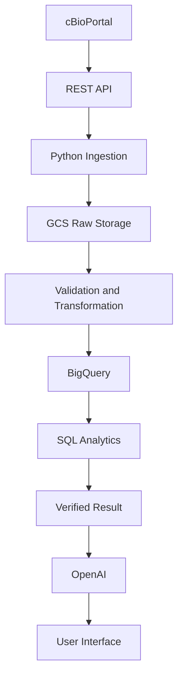
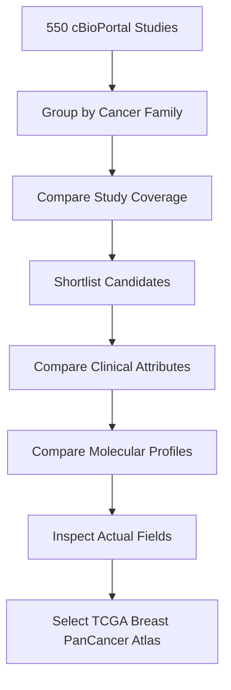

cat > docs/project_journey.md <<'EOF'
# BioData Copilot — Project Journey

## Project Goal

Build a biomedical data platform that:

1. retrieves public biomedical data,
2. preserves raw data,
3. validates and transforms it,
4. stores analytical data in BigQuery,
5. answers questions using SQL,
6. uses an LLM to explain verified results.

---

# Current Architecture

---

# Progress

| Phase | Status |
|---|---|
| Project setup | ✅ |
| API understanding | ✅ |
| Study exploration | ✅ |
| Cancer-family grouping | ✅ |
| Candidate comparison | ✅ |
| Dataset selection | ✅ |
| Actual clinical-data ingestion | ⏳ |
| Mutation-data ingestion | ⏳ |
| GCS | ⏳ |
| Data validation | ⏳ |
| BigQuery | ⏳ |
| OpenAI | ⏳ |
| UI | ⏳ |
| Raw clinical-data profiling | ✅ |
| Clinical-data transformation | ⏳ |
| Clinical-data transformation | ✅ |
| Wide-table validation | ✅ |
| Value profiling | ✅ |
| Analytics-table creation | ✅ |
| Mutation-data ingestion | ⏳ |
| GCS | ⏳ |
| BigQuery | ⏳ |
| Mutation-data ingestion | ✅ |
| Mutation-data profiling | ✅ |
| Mutation coverage validation | ✅ |
| GCS raw-data storage | ⏳ |
| BigQuery | ⏳ |
| OpenAI | ⏳ |
| UI | ⏳ |
| Stage | Status |
|---|---|
| Dataset selection | ✅ |
| Clinical ingestion | ✅ |
| Clinical validation | ✅ |
| Mutation ingestion | ✅ |
| Mutation validation | ✅ |
| GCS raw storage | ✅ |
| BigQuery warehouse | ⏳ |
| SQL analytics | ⏳ |
| OpenAI explanation layer | ⏳ |
| UI | ⏳ |
---

# Selected Dataset

Study ID:

`brca_tcga_pan_can_atlas_2018`

Study:

Breast Invasive Carcinoma — TCGA PanCancer Atlas

---

# Why This Dataset

Provides broad:

- demographic data
- tumour stage
- subtype
- survival
- mutation data
- gene expression
- copy-number information
- methylation
- protein information
- structural variants

---

# Dataset Selection Flow

---

# Scripts So Far

| Script | Purpose |
|---|---|
| `explore_studies.py` | Initial cBioPortal exploration |
| `compare_cancer_types.py` | Cancer-family comparison |
| `compare_candidate_studies.py` | Candidate metadata comparison |
| `inspect_study.py` | Detailed study inspection |

---

# Key Lessons

1. The biggest dataset is not automatically the best dataset.
2. More columns do not automatically mean better data.
3. Structured metadata is better than relying only on text searches.
4. Related cancer types may need to be grouped using hierarchy.
5. Start with simple Python and refactor later.
6. The LLM should not be the source of numerical truth.
7. Validate transformations after reshaping data.
8. Do not fill missing values without a reason.
9. Do not delete outliers without evidence.
10. Keep only V1-relevant columns in analytics tables.

---

# V1 Scope

Use:

- Clinical data
- Mutation data

Not yet:

- mRNA analysis
- methylation analysis
- protein analysis
- RAG
- ML models
- natural-language-to-SQL

---

# Current Next Step

Retrieve actual clinical records from:

`brca_tcga_pan_can_atlas_2018`

Then determine:

1. what the API response looks like,
2. whether records are patient-level or sample-level,
3. how many records exist,
4. how attributes are represented,
5. how raw data should be stored.

# Current Next Step

Transform the patient-level and sample-level clinical data from long format into wide analytical tables.

Example:

Long format:

patientId | clinicalAttributeId | value

Wide format:

patientId | AGE | SEX | OS_MONTHS | OS_STATUS | ...

# Current Next Step

Begin mutation-data ingestion for the selected study.

The goal is to retrieve actual gene-level mutation records and connect them to the existing sample/patient analytics tables.

# Current Next Step

Move the raw and processed project data into Google Cloud Storage.

The next stage will introduce the cloud storage layer while preserving the same raw-data structure created locally.
### Finding 6

The selected study contains 1,084 unique patients and 1,084 unique samples.

No patient had more than one sample in the sample-level clinical dataset.

Observed relationship:

`1 patient → 1 sample`

This will simplify future joins between patient and sample data.

### Finding 7

The raw clinical data contains no duplicate entity-attribute pairs.

Patient-level attributes have more variable completeness than sample-level attributes.

Sample-level clinical attributes are generally highly complete.

The raw long-format data is ready for transformation.
### Finding 8

The selected study contains 1,066 samples profiled for mutation data.

Only 1,009 samples have at least one returned mutation record.

Therefore:

`sequenced sample ≠ sample with a mutation`

### Finding 9

The mutation dataset contains:

- 84,226 mutation records
- 1,009 patients with mutation records
- 16,488 unique genes

### Finding 10

Raw mutation-record frequency and patient-level gene frequency are different measures.

Patient-level gene frequency is more useful for questions such as:

"How many patients have a mutation in TP53?"
## Day 5 — Cloud Storage Layer

The project moved from local-only storage to its first cloud infrastructure.

### Before

cBioPortal
→ Python
→ Local raw files

### After

cBioPortal
→ Python
→ Local raw files
→ Google Cloud Storage

### GCS Structure

biodata-copilot-haneefa-raw/
└── raw/
    ├── patient_clinical_data.json
    ├── sample_clinical_data.json
    └── mutation_data.json

### Completed

- Google Cloud CLI installed
- Google Cloud project configured
- Application Default Credentials configured
- GCS bucket created
- Raw files uploaded manually using the CLI
- Upload sizes validated
- `google-cloud-storage` Python library installed
- Python upload script created and tested

### Key Learning

The same GCS operation can be performed through:

- Google Cloud Console
- `gcloud` CLI
- Python SDK

The Python method is important because future pipeline execution should not depend on manually uploading files.
EOF