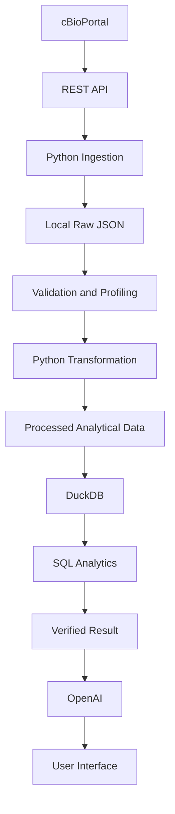

# BioData Copilot — Project Scope

## Problem

Biomedical datasets can contain many records, variables, missing values, and domain-specific information, making them difficult to inspect and interpret quickly.

## Goal

Build a biomedical data platform that:

1. Retrieves public biomedical data.
2. Preserves the original source data.
3. Validates and profiles the data.
4. Transforms semi-structured biomedical data into analytical datasets.
5. Stores the analytical data in a local SQL analytical database.
6. Answers predefined analytical questions using SQL.
7. Uses an LLM to explain verified query results.

## Target User

A student or researcher exploring biomedical data.

## Core Principle

The database calculates facts.

The LLM explains verified facts.

The LLM should not be the source of numerical truth.

## V1 Architecture

## V1 Scope

- One biomedical dataset
- cBioPortal REST API
- Python ingestion
- Raw JSON preservation
- Data validation and profiling
- Pandas transformation
- Clinical and mutation analytics datasets
- DuckDB analytical database
- SQL analytical models
- 3–5 supported analytical questions
- OpenAI explanation layer
- Simple user interface

## Out of Scope for V1

- Medical diagnosis
- Treatment recommendations
- Machine-learning prediction
- Arbitrary natural-language-to-SQL
- Multiple biomedical datasets
- RAG
- Large-scale distributed processing
- Spark
- Production cloud deployment
- BigQuery as a required component

## Interpretation Rule

BioData Copilot will distinguish between:

- directly measurable facts,
- observed associations,
- interpretations requiring additional scientific evidence,
- causal or clinical conclusions that cannot be supported by the dataset alone.

## Cloud Exploration

Google Cloud was explored during development.

The project successfully tested:

- Google Cloud CLI
- Google Cloud authentication
- Application Default Credentials
- Google Cloud Storage
- Python `google-cloud-storage`
- raw file uploads
- processed file uploads

GCP is not required for V1 because the current dataset is small enough to process comfortably on a local machine.

The cloud architecture is retained as a possible Phase 2 extension rather than being forced into the initial implementation.

## Future Extensions

- GCS-backed storage
- BigQuery analytical warehouse
- Cloud Run deployment
- Scheduled cloud ingestion
- Scientific literature retrieval
- RAG
- Natural-language-to-SQL
- Data lineage and provenance
- Machine-learning experiments
- Trustworthy biomedical AI evaluation